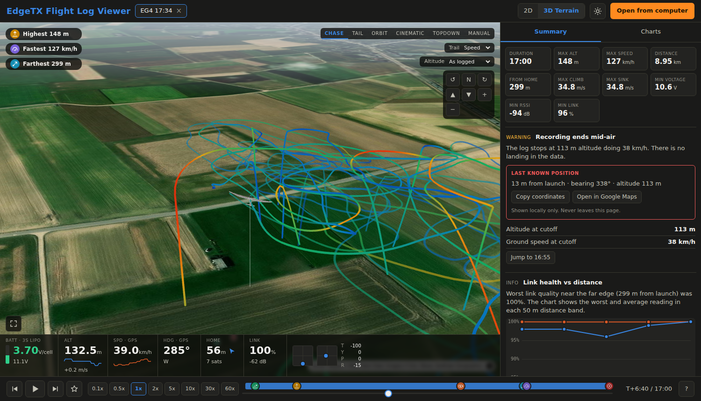

<p align="center">
  
</p>

<h1 align="center">EdgeTX Flight Log Viewer</h1>

<p align="center">
  <a href="https://flg.kaankolkoy.net"><b>https://flg.kaankolkoy.net</b></a><br>
</p>

<p align="center">
  Replay your EdgeTX telemetry logs on a 3D terrain map. Runs entirely in the browser, no account, no API token, no upload.
</p>


<p align="center">
  
</p>

## Features

- 3D satellite map with real terrain, 2D mode, and six camera presets: Chase, Tail, Orbit, Cinematic, Topdown, Manual.
- Smooth playback between GPS fixes. Raw values are never altered, the aircraft path is interpolated for display only.
- HUD strip: battery per cell, altitude, GPS speed, GPS heading, distance and direction to home, link quality, RSSI and stick positions (Mode 2).
- Summary tab with highest, fastest and farthest points, climb and sink rates, link health versus distance, last known position and telemetry update rates.
- Charts tab with altitude, vertical speed, speed, heading, distance, voltage, link, RSSI, sticks and satellites. Click any chart to seek.
- Timeline markers for launch, landing, low voltage, link drops and signal loss.
- Open several logs at once, pick saved logs from a dropdown, or drag and drop files.
- Altitude is shown as logged (`Alt(m)`), with an optional "Above launch" mode for barometric sensors that start at 0.
- Metric units, light and dark themes.

## Using it

Use the hosted version at https://flg.kaankolkoy.net, or run your own copy (below). Your logs are read in your browser and never uploaded.

1. Put your EdgeTX CSV logs in the `logs/` folder, or use **Open from computer** to load a file from disk.
2. Pick a log from the **Saved logs** dropdown (shown as `YYYY-MM-DD HH:MM:SS`).

Required CSV columns are `Date`, `Time` and `GPS`. Everything else is optional and shown when present. The home point is the first GPS fix with at least 6 satellites.

## Run locally

Any static file server works. ES modules do not load from `file://`.

```sh
npm start
```

Open http://localhost:8080. The dropdown reads the directory listing of `logs/`, which this server provides.

For hosts without directory listings (GitHub Pages, S3, and so on), generate a manifest after adding logs:

```sh
npm run index
```

This writes `logs/index.json`, which the page reads first.

## Tests

```sh
npm test
```

Requires Node 22 or newer. No dependencies are installed.

## Docker

The image is `nginx:alpine` plus the static files, with directory listing enabled for `/logs/`.

```sh
docker build -t edgetx-flight-log-viewer .
docker run --rm -p 8080:80 -v "$PWD/logs:/usr/share/nginx/html/logs:ro" edgetx-flight-log-viewer
```

Logs added to the mounted folder appear after a page reload, no rebuild needed.

## Data sources

- Imagery: Esri World Imagery tiles.
- Terrain: AWS Terrain Tiles (terrarium encoding).
- Rendering: [MapLibre GL JS](https://maplibre.org/) and [three.js](https://threejs.org/), both bundled in `vendor/`.

Map tiles are fetched from those services by the visitor's browser. Your log files are never sent anywhere.

## Notes

- Aircraft bank and pitch are estimated from the flight path, EdgeTX logs do not record attitude.
- GPS in typical flight controllers updates about every 3 seconds. Lowering the SD Logs interval in EdgeTX gives finer stick and link data, but not more GPS fixes.
- This is an independent project. It is not affiliated with or endorsed by EdgeTX, and the logo is a redraw inspired by the EdgeTX logo, which belongs to its authors.
